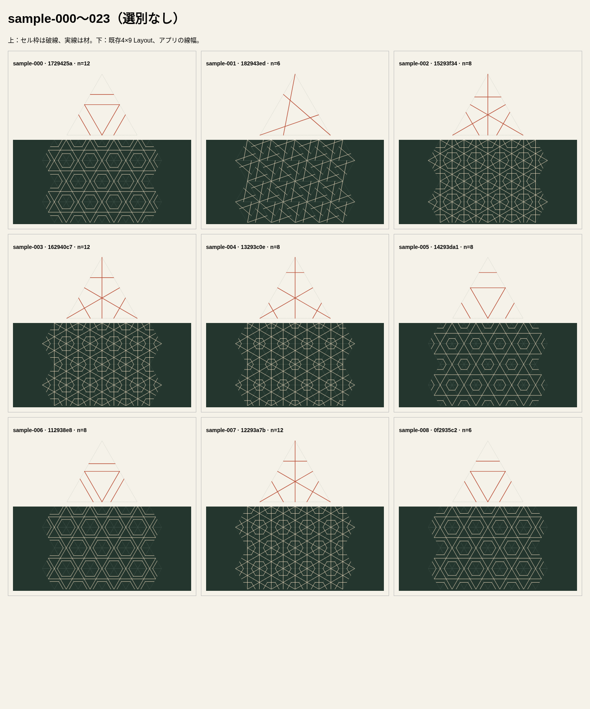
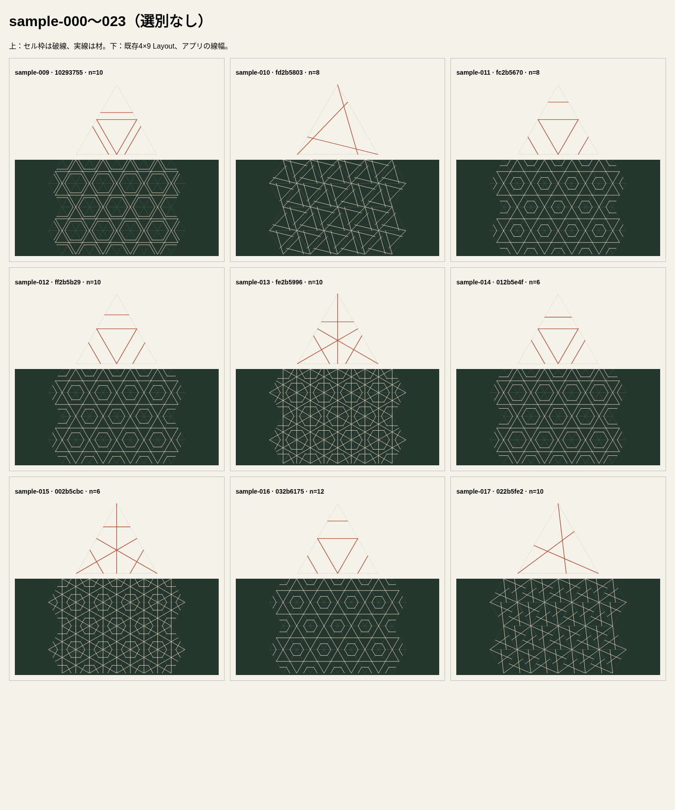
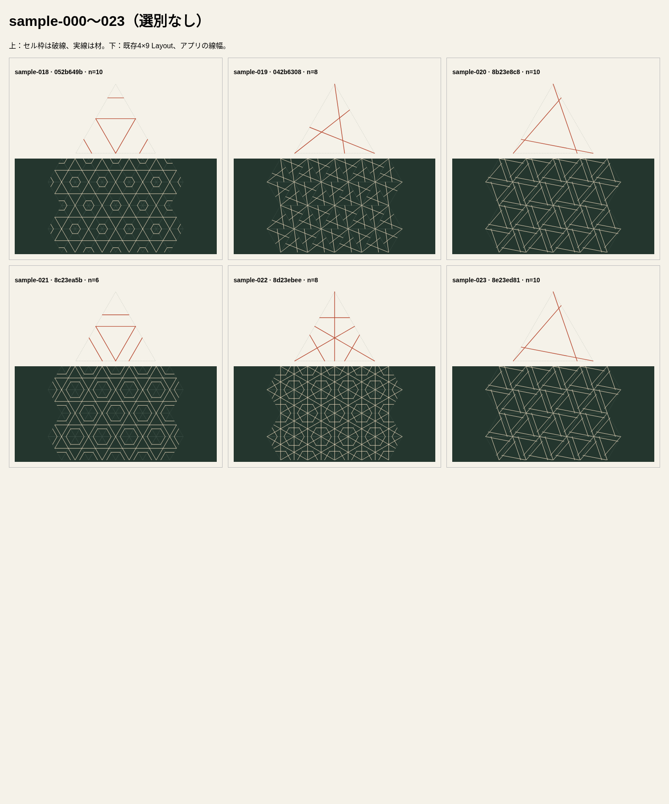

# Issue #74 検証記録

仕様・生成規則の正本は[プロダクト仕様](../../spec.md#文様生成)と[Generator Architecture](../../architecture/generator.md)。本書は初版の検証証跡であり、規範を追加しない。

## 自動検証

実行結果: `npm run test:contracts`（72契約）、`npm test`（19ファイル・207件）、`npm run build`、`git diff --check`はすべて成功。

- 固定入力6件のseed、論理Anchor、source ID、Symmetry、分割数を設計時の固定値と比較。風車の両向き、3構成、raw seed 0の経路を確認。
- 改行・NFC、前後空白、UTF-16境界長、孤立surrogate、未対応recipe、入力不変と別呼出し間の独立性を確認。
- 有限空間の全48組合せ（3構成×8個のn/k×2向き）が成功し、source数、展開数、非退化、overlapなしを確認。
- UI統合で、手描きからの候補生成・失敗・入力変更・取消し、split・材なしを含むPatternの全置換、同ID再生成時の旧端点編集終了、適用後の追加・削除・端点変更、生成元表示を確認。
- Pattern参照または分割数が競合した古い適用をpure helperで拒否し、現状態を基準に再生成できることを確認。
- jsdomのdialog APIだけをテストで代替。modalの実動作は次のブラウザ確認と区別する。

## ブラウザ操作

Chromium 151.0.7922.173、headless、Playwright経由でローカルVite画面を操作。

- Desktop 1280×1000: 初期focus、Tab巡回、背景へのfocus/pointer遮断、入力→候補→適用、未適用のEscape取消し、終了時の起点へのfocus復帰。
- Mobile 390×844、タッチエミュレーション: 生成・閉じる・適用・空白入力の失敗。dialog内スクロールと元Pattern維持。
- 適用後の通常UI: 端点変更、Segment追加・削除、split追加、材なし・材復元。
- JavaScriptのpageerrorなし。

画面: [Desktop](desktop.png)、[Mobile](mobile.png)。スマートフォンの画像はスクロール前。適用・閉じるボタンはdialog内をスクロールして操作した。

## 選別しない生成例

`sample-000`〜`sample-023`を連番で24回生成した。全件の候補セル図と4×9敷き詰めSVGを画面から収集し、アプリと同じ線幅・色で一覧化した。3構成すべてが含まれ、追加例・seed差替え・間引きはない。セル枠は破線の補助線、実線が材。敷き詰めの暗い三角形線も補助線である。

### 所見

- 輪郭は中点三角形と角を切る線が規則的に並び、六角形状の大きな余白が読み取れる。
- 放射は中央への集まりが明瞭だが、輪郭より交点と小区画が多い。特にsample-002 / 003 / 007 / 022は敷き詰めで密度が高い。線の乱立ではなく同じ構成の反復として見えるが、加工時の最小区画や強度を保証しない。
- 風車は傾き・向きの差が分かる一方、セル境界で線が途切れる。補助セル枠を材と見なすと連結しているように誤認し得るため、連続性の保証はしない。
- 同じ見た目は実際に複数回出現する（例: 000 / 008、002 / 022、010 / 019）。分母の異なる論理Anchorでも同じ比率のGeometryになる。生成空間は小さく、24件すべてが異なる形になる体験ではない。
- 全件を一度の生成で確認でき、空結果や候補枯渇はなかった。美しさを数値評価したものではなく、美的品質や「当たり率」を保証しない。

## 未確認事項

- 実機スマートフォン、Safari / Firefox、スクリーンリーダーの読み上げは未確認。タッチはChromiumエミュレーション。
- 実加工、構造強度、セル境界での連結性は今回の検証・保証対象外。
